# ERD đầy đủ

38 bảng và 51 khóa ngoại. Một hành khách có thể tham gia nhiều chuyến; mỗi đặt chỗ có một tài khoản chi tiêu. Một tài khoản tạo tối đa một hóa đơn cuối chuyến.

```mermaid
erDiagram
    Accounts {
        int AccountId PK
        int BookingId FK
        varchar Status
    }
    Activities {
        int ActivityId PK
        int CruiseId FK
        int ZoneId FK
        int StopId FK
        int ProviderId FK
        nvarchar Name
        varchar Kind
        datetime2 StartsAt
        datetime2 EndsAt
        datetime2 ReturnAt
        int Capacity
        decimal Fee
        varchar Status
        int IncludedServiceId FK
    }
    AuditLog {
        bigint LogId PK
        varchar Entity
        int EntityId
        varchar Action
        int ActorId
        datetime2 CreatedAt
    }
    BLELocations {
        bigint LocationId PK
        int WearableId FK
        int ReceiverId FK
        datetime2 ObservedAt
    }
    BLEReceivers {
        int ReceiverId PK
        int ZoneId FK
        varchar Code
    }
    Bookings {
        int BookingId PK
        int CruiseId FK
        int PassengerId FK
        int CabinId FK
        int PackageId FK
    }
    Cabins {
        int CabinId PK
        int ShipId FK
        varchar Number
    }
    CruiseFeedback {
        int BookingId PK
        int Rating
        nvarchar Comment
        datetime2 CreatedAt
    }
    Cruises {
        int CruiseId PK
        int ShipId FK
        nvarchar Name
        date StartDate
        date EndDate
        varchar Status
    }
    CheckIns {
        int CheckInId PK
        int RegistrationId FK
        int DeviceId FK
        int StaffId FK
        datetime2 CreatedAt
        datetime2 ReturnedAt
    }
    Devices {
        int DeviceId PK
        nvarchar Name
        varchar Kind
    }
    Disputes {
        int DisputeId PK
        int TransactionId FK
        nvarchar Reason
        varchar Status
        datetime2 SubmittedAt
        int SubmittedBy FK
        datetime2 ResolvedAt
        int ResolvedBy FK
        nvarchar Resolution
    }
    Feedback {
        int FeedbackId PK
        int RegistrationId FK
        int Rating
        nvarchar Comment
    }
    GroupMembers {
        int RegistrationId PK
        int GroupId FK
    }
    Identifiers {
        int IdentifierId PK
        int BookingId FK
        varchar Code
        varchar Kind
        bit Active
    }
    Invoices {
        int InvoiceId PK
        int AccountId FK
        decimal Total
        datetime2 CreatedAt
    }
    ItineraryChanges {
        int ChangeId PK
        int StopId FK
        datetime2 OldArrival
        datetime2 OldDeparture
        datetime2 NewArrival
        datetime2 NewDeparture
        nvarchar Reason
        int StaffId FK
        datetime2 CreatedAt
    }
    NotificationReads {
        int NotificationId PK
        int UserId PK
        datetime2 ReadAt
    }
    Notifications {
        int NotificationId PK
        int CruiseId FK
        nvarchar Message
        datetime2 CreatedAt
    }
    Packages {
        int PackageId PK
        nvarchar Name
    }
    PackageServices {
        int PackageId PK
        int ServiceId PK
    }
    Passengers {
        int PassengerId PK
        int UserId FK
    }
    Payments {
        int PaymentId PK
        int InvoiceId FK
        decimal Amount
        varchar Method
        datetime2 CreatedAt
    }
    Policy {
        int PolicyId PK
        int CancelHours
        int RefundPercent
    }
    Ports {
        int PortId PK
        nvarchar Name
    }
    Providers {
        int ProviderId PK
        nvarchar Name
    }
    Registrations {
        int RegistrationId PK
        int ActivityId FK
        int BookingId FK
        varchar Status
        datetime2 CreatedAt
    }
    Roles {
        int RoleId PK
        varchar Code
        nvarchar Name
    }
    Services {
        int ServiceId PK
        nvarchar Name
        decimal Price
    }
    Ships {
        int ShipId PK
        nvarchar Name
        int Capacity
    }
    Stops {
        int StopId PK
        int CruiseId FK
        int PortId FK
        datetime2 Arrival
        datetime2 Departure
    }
    SyncReceipts {
        uniqueidentifier ClientId PK
        int DeviceId FK
        datetime2 SyncedAt
    }
    TourGroups {
        int GroupId PK
        int ActivityId FK
        nvarchar Name
        nvarchar Vehicle
        nvarchar Guide
    }
    Transactions {
        int TransactionId PK
        int AccountId FK
        int RegistrationId FK
        int ServiceId FK
        int DeviceId FK
        int StaffId FK
        uniqueidentifier ClientId
        int Quantity
        decimal Amount
        varchar Status
        datetime2 CreatedAt
        decimal RefundAmount
        varchar SyncStatus
        datetime2 ReconciledAt
        int ReconciledBy FK
    }
    UserRoles {
        int UserId PK
        int RoleId PK
    }
    Users {
        int UserId PK
        nvarchar Name
        varchar Email
        varchar PasswordHash
        bit Active
    }
    Wearables {
        int WearableId PK
        int BookingId FK
        varchar Code
    }
    Zones {
        int ZoneId PK
        int ShipId FK
        nvarchar Name
    }
    Transactions ||--o{ SyncReceipts : "ClientId"
    Devices ||--o{ SyncReceipts : "DeviceId"
    Bookings ||--o{ Wearables : "BookingId"
    Zones ||--o{ BLEReceivers : "ZoneId"
    Packages ||--o{ PackageServices : "PackageId"
    Services ||--o{ PackageServices : "ServiceId"
    Wearables ||--o{ BLELocations : "WearableId"
    BLEReceivers ||--o{ BLELocations : "ReceiverId"
    Notifications ||--o{ NotificationReads : "NotificationId"
    Users ||--o{ NotificationReads : "UserId"
    Activities ||--o{ Registrations : "ActivityId"
    Bookings ||--o{ Registrations : "BookingId"
    Bookings ||--o{ Identifiers : "BookingId"
    Registrations ||--o{ CheckIns : "RegistrationId"
    Devices ||--o{ CheckIns : "DeviceId"
    Users ||--o{ CheckIns : "StaffId"
    Bookings ||--o{ Accounts : "BookingId"
    Accounts ||--o{ Transactions : "AccountId"
    Registrations ||--o{ Transactions : "RegistrationId"
    Services ||--o{ Transactions : "ServiceId"
    Devices ||--o{ Transactions : "DeviceId"
    Users ||--o{ Transactions : "StaffId"
    Users ||--o{ Transactions : "ReconciledBy"
    Transactions ||--o{ Disputes : "TransactionId"
    Accounts ||--o{ Invoices : "AccountId"
    Invoices ||--o{ Payments : "InvoiceId"
    Ships ||--o{ Zones : "ShipId"
    Cruises ||--o{ Notifications : "CruiseId"
    Ships ||--o{ Cabins : "ShipId"
    Stops ||--o{ ItineraryChanges : "StopId"
    Users ||--o{ ItineraryChanges : "StaffId"
    Ships ||--o{ Cruises : "ShipId"
    Registrations ||--o{ Feedback : "RegistrationId"
    Cruises ||--o{ Stops : "CruiseId"
    Ports ||--o{ Stops : "PortId"
    Users ||--o{ UserRoles : "UserId"
    Roles ||--o{ UserRoles : "RoleId"
    Users ||--o{ Passengers : "UserId"
    Services ||--o{ Activities : "IncludedServiceId"
    Cruises ||--o{ Bookings : "CruiseId"
    Passengers ||--o{ Bookings : "PassengerId"
    Activities ||--o{ TourGroups : "ActivityId"
    Cabins ||--o{ Bookings : "CabinId"
    Packages ||--o{ Bookings : "PackageId"
    Registrations ||--o{ GroupMembers : "RegistrationId"
    TourGroups ||--o{ GroupMembers : "GroupId"
    Cruises ||--o{ Activities : "CruiseId"
    Bookings ||--o{ CruiseFeedback : "BookingId"
    Zones ||--o{ Activities : "ZoneId"
    Stops ||--o{ Activities : "StopId"
    Providers ||--o{ Activities : "ProviderId"
```

Ký hiệu cạnh biểu diễn khóa ngoại. Một số quan hệ bị giới hạn thành 1–1 bởi UNIQUE; xem script và từ điển dữ liệu để biết ràng buộc chính xác.
